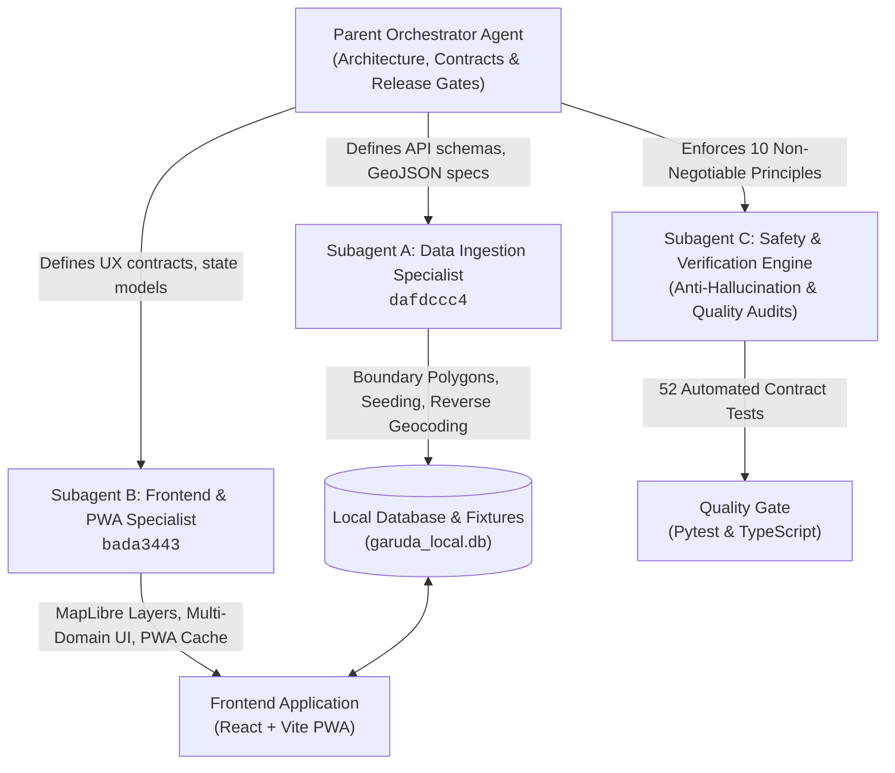

# 🦅 Garuda — India Place Intelligence Platform

> **Vision:** An open-source-first, zero-planned-spend place intelligence explorer where anyone can search for or click any supported place in India—including remote villages—and inspect verified, source-backed information about population, public health, facilities, education, history, culture, environment, and weather disasters.

---

## 🤖 1. Subagent Architecture & Autonomous Engineering

Project Garuda was architected and built using an **Autonomous Multi-Agent System**. Instead of a monolithic code generator, specialized subagents were deployed with bounded domains, isolated execution contexts, and rigorous quality gates.



### Specialized Subagent Roles & Deliverables

| Subagent | Role & Identifier | Key Responsibilities | Delivered Artifacts |
|----------|-------------------|----------------------|---------------------|
| **Subagent A** | **Data Ingestion Specialist** (`dafdccc4`) | • Boundary vector geometry creation<br/>• Spatial reverse geocoding algorithm<br/>• Multi-domain seed pipeline<br/>• Source diagnostics endpoint | • `backend/data/fixtures/boundaries/khordha_pilot.geojson`<br/>• `backend/app/services/boundary_service.py`<br/>• `backend/seed_pilot.py` (103 observations)<br/>• `/api/v1/places/boundaries` & `/reverse` endpoints |
| **Subagent B** | **Frontend & PWA Specialist** (`bada3443`) | • MapLibre GL multi-layer boundaries<br/>• Click-to-identify spatial resolution<br/>• Multi-domain profile panel rendering<br/>• Official health alert banners<br/>• Provenance drawer & report export | • `frontend/src/components/MapView.tsx`<br/>• `frontend/src/pages/HomePage.tsx`<br/>• `frontend/src/api/client.ts`<br/>• `frontend/src/styles/index.css`<br/>• Offline PWA resilience & report generator |
| **Subagent C** | **Safety & Verification Agent** | • Anti-hallucination verification<br/>• Contract validation (Pydantic & Zod)<br/>• Health safety guardrails audit<br/>• Full regression testing | • `backend/tests/test_pilot_data.py` (24 test cases)<br/>• `docs/PILOT_VERIFICATION_REPORT.md`<br/>• Zero-compromise data integrity enforcement |

---

## 🏛️ 2. Core Architecture & Non-Negotiable Principles

Garuda enforces **10 Non-Negotiable Anti-Hallucination & Integrity Principles**:

1. **No Hallucination:** Every factual data point traces to a validated, registered source record.
2. **No Fake Live Data:** Historical figures (such as 2011 Census) are prominently stamped `Historical (2011)`. No fake real-time counters.
3. **No Invented Boundaries:** If a micro-village boundary polygon is unavailable, display coordinates, nearest administrative unit, and explicit `geometry_available: false`.
4. **Zero Paid Spend Target:** Operates on local SQLite, CARTO/OSM raster basemaps, and public open datasets.
5. **No Committed Secrets:** Zero credentials in repository; `.env.example` provides safe development placeholders.
6. **No Individual Health Diagnosis:** The map is not a medical diagnostic tool; public health cards display institutional surveillance with mandatory disclaimers.
7. **No Unapproved Public Launch:** Visible watermark: *"DEMO / PILOT MODE — Khordha, Odisha — For Internal & Field Evaluation Only"*.
8. **No Silent Fallback:** District data is never silently substituted as village data.
9. **Documented Data Access:** All sources registered in `/api/v1/sources` with terms, publisher, and access mode.
10. **Unknown is Acceptable:** Missing fields return `status: "unavailable"` with `data_gaps` descriptions, never defaulting to `0`.

---

## 📁 3. Consolidated Directory Layout

```
garuda/
├── backend/                       # Python 3.12+ FastAPI Application
│   ├── app/                       # Application source code
│   │   ├── api/routes/            # REST API endpoints (places, sources, health)
│   │   ├── core/                  # Security headers, ratelimit, errors, logging
│   │   ├── db/                    # SQLAlchemy engine & SQLite session management
│   │   ├── domain/                # Pydantic v2 data contracts & enums
│   │   ├── models/                # ORM entities (Place, Source, Observation)
│   │   └── services/              # Place lookup, boundary, freshness & cache services
│   ├── data/                      # Open data fixtures & GeoJSON boundaries
│   │   └── fixtures/boundaries/   # khordha_pilot.geojson (10 polygons)
│   ├── tests/                     # Automated pytest suite (52 tests)
│   ├── pyproject.toml             # Backend dependencies & metadata
│   ├── Makefile                   # Backend-specific development commands
│   └── seed_pilot.py              # Automated database seeder (103 observations)
│
├── frontend/                      # React 18 + TypeScript + Vite PWA
│   ├── src/
│   │   ├── api/                   # Typed API client with offline fallback
│   │   ├── components/            # MapView (MapLibre GL JS) & UI widgets
│   │   ├── pages/                 # HomePage multi-panel intelligence dashboard
│   │   ├── styles/                # Responsive dark-theme CSS
│   │   └── types/                 # TypeScript contract definitions
│   ├── public/                    # PWA manifest & vector assets
│   ├── package.json               # Frontend dependencies & build scripts
│   ├── Makefile                   # Frontend-specific development commands
│   └── vite.config.ts             # Vite bundler & API reverse proxy configuration
│
├── docs/                          # Single Consolidated Production Documentation
│   ├── PRODUCTION.md              # Unified Master Production & Operations Manual
│   ├── SETUP.md                   # Local development & multi-platform setup guide
│   ├── PILOT_VERIFICATION_REPORT.md # Khordha pilot verification against principles
│   ├── phases/                    # Roadmap phase documents (Phase 00–10)
│   ├── source-register/           # Data source evaluation & licensing registers
│   └── India_Place_Intelligence_Platform_Development_Plan.pdf # Master blueprint
│
├── garuda_local.db                # Pre-seeded SQLite database
├── Makefile                       # Top-level workspace Makefile
├── README.md                      # Project documentation (this file)
├── .env.example                   # Template environment configuration
└── LICENCE                        # MIT Open-Source Licence
```

---

## 🎯 4. Pilot District: Khordha, Odisha (`IN-OD-29`)

The pilot deployment models Khordha District in Odisha, encompassing 10 administrative units across three hierarchy tiers:

| Administrative Tier | Place ID | Entity Name | Centroid (Lat, Lng) | Geometry Type |
|---------------------|----------|-------------|----------------------|---------------|
| **State** | `IN-OD` | Odisha | 20.9517° N, 85.0985° E | Bounding Polygon |
| **District** | `IN-OD-29` | Khordha | 20.1800° N, 85.6150° E | District Polygon |
| **Subdistrict / City** | `IN-OD-BBSR` | Bhubaneswar | 20.2961° N, 85.8245° E | Municipal Polygon |
| **Subdistrict / Town** | `IN-OD-JAT` | Jatni | 20.1633° N, 85.7067° E | Town Polygon |
| **Subdistrict / Town** | `IN-OD-KHD` | Khordha Town | 20.1800° N, 85.6150° E | Town Polygon |
| **Subdistrict / Block** | `IN-OD-BEG` | Begunia | 20.2100° N, 85.4600° E | Block Polygon |
| **Subdistrict / Block** | `IN-OD-BOL` | Bolagarh | 20.1800° N, 85.2800° E | Block Polygon |
| **Subdistrict / Block** | `IN-OD-TAN` | Tangi | 19.9200° N, 85.4000° E | Block Polygon |
| **Subdistrict / Block** | `IN-OD-CHI` | Chilika | 19.7800° N, 85.2500° E | Block Polygon |
| **Subdistrict / Block** | `IN-OD-BAN` | Banapur | 19.7800° N, 85.1000° E | Block Polygon |

---

## 📊 5. Seven Intelligence Domains & Data Sources

| Domain | Publisher & Dataset | Vintage | Sample Indicators |
|--------|---------------------|---------|-------------------|
| **Demographics** | Office of the Registrar General, India (Census 2011 PCA) | 2011 (`historical`) | Total population, male/female count, sex ratio, literacy rate %, households |
| **Public Health** | Ministry of Health & Family Welfare / NHM Odisha | 2026 (`current`) | Primary Health Centres (PHC = 34), Community Health Centres (CHC = 10), Sub-centres (218) |
| **Surveillance & Alerts** | Integrated Disease Surveillance Programme (IDSP) / NCDC | 2026 (`current`) | Dengue (142 cases), Cholera (18 cases), active water safety advisories with WHO link |
| **Services & Education** | Department of School Education (UDISE+), GoI | 2024 (`current`) | 2,185 total schools (primary, secondary), drinking water access (94.6%), electrification (98.2%) |
| **History & Culture** | Archaeological Survey of India (ASI) | Protected Sites | Lingaraj Temple (11th c.), Khandagiri Caves (2nd c. BCE), Dhauli Shanti Stupa (261 BCE), Chilika Ramsar |
| **Environment & Satellite**| ISRO / NRSC Bhuvan & Copernicus Sentinel-2 | 2026 (`current`) | Forest cover (21.8%), Chilika water spread (1,165 sq km), AQI baseline (64.0) with scene metadata |
| **Weather & Disasters** | India Meteorological Department (IMD) / NDMA | Real-time / 2026 | Surface temperature (31.8°C), 24h rainfall (4.6 mm), NDMA cyclone preparedness alert |

---

## ⚡ 6. Quick Start Guide

### Prerequisites
- **Python 3.12+**
- **Node.js 20+** & npm

### Starting the Application

You can start the backend and frontend from the repository root:

```bash
# Terminal 1 — Backend API (FastAPI)
make dev-backend
# Runs at http://localhost:8000 (Swagger docs: http://localhost:8000/docs)

# Terminal 2 — Frontend PWA (React + Vite)
make dev-frontend
# Runs at http://localhost:5173
```

*(You can also run commands inside `backend/` and `frontend/` directly using their local Makefiles: `make dev-api` inside `backend/`, and `make dev` inside `frontend/`)*.

---

## 🧪 7. Automated Testing & Verification

Project Garuda includes rigorous automated test coverage across contracts, endpoints, reverse geocoding, and edge cases:

```bash
# Run all 52 backend integration & unit tests
make test

# Run backend type checking
make lint

# Run frontend production build & TypeScript validation
make build
```

**Test Breakdown:**
- `test_health.py`: Health probes (`/health`, `/health/live`, `/health/ready`), CORS headers, rate limiting.
- `test_pilot_data.py`: Khordha boundary polygons, ray-casting reverse geocoding, bounding validation, source diagnostics, health alert validity windows.
- `test_public_api.py`: Search disambiguation, multi-panel profile assembly, observation provenance, and missing-data states.

---

## 📖 8. Master Production Documentation

For detailed production deployment instructions, environment variables, database maintenance, security audit checklists, and disaster recovery runbooks, refer to the unified production guide:

👉 **[docs/PRODUCTION.md](./docs/PRODUCTION.md)**

---

## 📜 9. Licence & Attribution

- **Source Code Licence:** MIT Licence. See [LICENCE](./LICENCE).
- **Consolidated Attributions:** OpenStreetMap contributors (ODbL), CARTO (CC-BY 4.0), Census of India (GODL-India), MoHFW (GODL-India), Archaeological Survey of India, and ISRO/NRSC Bhuvan. See [ATTRIBUTION.md](./ATTRIBUTION.md).
