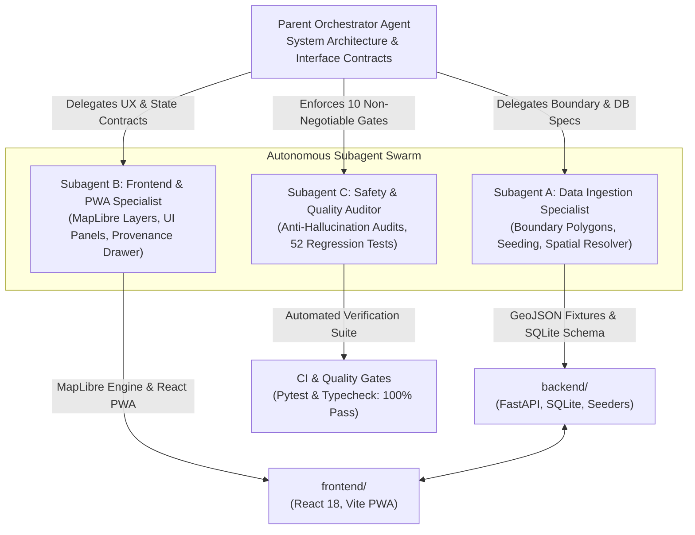
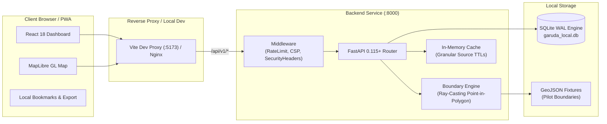

# Garuda — India Place Intelligence Platform

> **An open-source-first, zero-planned-spend explorer for India's administrative geography, public health, population, infrastructure, and environmental intelligence.**

Garuda provides deterministic, source-grounded place intelligence across India's administrative levels. From state down to village and coordinate level, users can search, inspect, and analyze multi-domain metrics without hallucinated defaults or unverified extrapolations.

---

## Table of Contents

- [Overview](#overview)
- [Key Features](#key-features)
- [Multi-Agent Engineering Architecture](#multi-agent-engineering-architecture)
- [System Architecture](#system-architecture)
- [Repository Structure](#repository-structure)
- [Prerequisites & Environment](#prerequisites--environment)
- [Installation & Setup](#installation--setup)
- [Quick Start](#quick-start)
- [Configuration Reference](#configuration-reference)
- [API Reference & Usage Examples](#api-reference--usage-examples)
- [Pilot Territory: Khordha District, Odisha](#pilot-territory-khordha-district-odisha)
- [Data Governance & Anti-Hallucination Principles](#data-governance--anti-hallucination-principles)
- [Testing & Quality Verification](#testing--quality-verification)
- [Security & Responsible Use](#security--responsible-use)
- [Troubleshooting](#troubleshooting)
- [Contributing](#contributing)
- [License & Attributions](#license--attributions)
- [Documentation Index](#documentation-index)

---

## Overview

### The Problem
Public data across India is fragmented across disparate bulletins, census abstracts, institutional websites, and PDF reports. When exploring remote or local districts, users and analysts often encounter:
- Outdated metrics presented as live figures without disclosure.
- Missing village-level data replaced by silent zero defaults or arbitrary interpolations.
- Misleading boundaries and unverified epidemiological claims.
- Commercial lock-in via paid mapping and geocoding APIs.

### The Solution
Garuda is designed around a strict anti-hallucination contract:
- **Every metric traces to a published source:** Publisher, license, reference period, and retrieval timestamp are recorded.
- **Missing data is explicitly labeled:** When data is unavailable, Garuda returns `status: "unavailable"` with documented data gaps, never a silent zero.
- **Historical data remains historical:** 2011 Census metrics are stamped `Historical (2011)`.
- **Zero-planned-spend:** Operates locally on SQLite (WAL mode), MapLibre GL JS with CARTO/OSM raster basemaps, and verified open public data fixtures.
- **Non-clinical public health data:** Official advisories and routine disease surveillance are strictly separated, accompanied by mandatory medical disclaimers.

---

## Key Features

- **Interactive Vector & Raster Mapping:** MapLibre GL JS integration rendering administrative boundaries with custom fill, line hierarchy, and dynamic place selection glows.
- **Point-in-Polygon Reverse Geocoding:** Click any coordinate on the map to resolve the enclosing administrative hierarchy (State → District → Subdistrict/Block/Town) using native ray-casting, with haversine nearest-centroid fallback.
- **Place Search & Name Disambiguation:** Fast substring search supporting official canonical names, search text, and historical aliases (e.g. searching *"Orissa"* resolves to *"Odisha"*; *"Khurda"* resolves to *"Khordha"`).
- **Multi-Domain Place Profiles:** Independent panel assembly across 7 domains: Demographics, Public Health, Health Surveillance/Alerts, Services & Education, History & Culture, Environment & Satellite, and Weather & Hazards.
- **Official Health Advisories:** Dedicated banner rendering active health alerts with issuing authority, validity window, severity, and direct links to authoritative WHO/MoHFW prevention guidance.
- **Provenance & Evidence Drawer:** Modal view displaying complete attribution metadata (publisher, dataset URL, license, verification status, and retrieval date).
- **Offline Resilience & Bookmarks:** PWA shell with `localStorage` place bookmarking, per-source cache TTLs, and one-click Markdown report exports.
- **Operational Source Diagnostics:** Endpoint and modal dashboard reporting real-time adapter health, observation counts, cache ages, and refresh cycles.

---

## Multi-Agent Engineering Architecture

Project Garuda was developed and validated using a specialized **Autonomous Multi-Agent System**. Each subagent operates within explicit domain boundaries, isolated workspaces, and deterministic quality gates:



### Subagent Responsibilities & Deliverables

| Agent Role | Primary Focus | Delivered Code & Artifacts |
|:---|:---|:---|
| **Data Ingestion Specialist** | Spatial boundaries, relational schema, data seeding, reverse geocoding | • [`backend/data/fixtures/boundaries/khordha_pilot.geojson`](./backend/data/fixtures/boundaries/khordha_pilot.geojson)<br/>• [`backend/app/services/boundary_service.py`](./backend/app/services/boundary_service.py)<br/>• [`backend/seed_pilot.py`](./backend/seed_pilot.py)<br/>• `/api/v1/places/boundaries` & `/reverse` endpoints |
| **Frontend & PWA Specialist** | MapLibre rendering, responsive UI, multi-domain panels, provenance drawer | • [`frontend/src/components/MapView.tsx`](./frontend/src/components/MapView.tsx)<br/>• [`frontend/src/pages/HomePage.tsx`](./frontend/src/pages/HomePage.tsx)<br/>• [`frontend/src/api/client.ts`](./frontend/src/api/client.ts)<br/>• Offline detection, report exporter & styling |
| **Safety & Quality Auditor** | Contract enforcement, anti-hallucination audits, regression tests | • [`backend/tests/test_pilot_data.py`](./backend/tests/test_pilot_data.py) (24 new test cases)<br/>• [`docs/PILOT_VERIFICATION_REPORT.md`](./docs/PILOT_VERIFICATION_REPORT.md)<br/>• 52/52 passing backend tests |

---

## System Architecture

Garuda combines an asynchronous FastAPI service with a client-side React PWA and a local SQLite database configured for high-concurrency read operations:



---

## Repository Structure

```
garuda/
├── backend/                       # FastAPI application, database & tests
│   ├── app/                       # Application package
│   │   ├── api/routes/            # REST route controllers (places, sources, health, admin)
│   │   ├── core/                  # Security headers, rate limiting, errors, configuration
│   │   ├── db/                    # SQLAlchemy engine, session maker & SQLite pragmas
│   │   ├── domain/                # Pydantic v2 data contracts, schemas & enums
│   │   ├── models/                # SQLAlchemy ORM entities (Place, Source, Observation)
│   │   └── services/              # Place service, boundary service, cache & freshness
│   ├── data/fixtures/             # Sample datasets and GeoJSON boundary files
│   │   └── boundaries/            # khordha_pilot.geojson (10 administrative polygons)
│   ├── tests/                     # Pytest suite (52 tests across unit & integration)
│   ├── Makefile                   # Backend commands (make dev, make test, make seed)
│   ├── pyproject.toml             # Python build configuration and dependencies
│   └── seed_pilot.py              # Automated database seeder (103 verified observations)
│
├── frontend/                      # React 18 + TypeScript + Vite PWA
│   ├── public/                    # Web manifest and static icons
│   ├── src/                       # Application source code
│   │   ├── api/                   # API client with resilient offline fallbacks
│   │   ├── components/            # MapView (MapLibre GL JS) and navigation widgets
│   │   ├── pages/                 # HomePage multi-panel intelligence explorer
│   │   ├── styles/                # High-contrast responsive dark theme
│   │   └── types/                 # Shared TypeScript contract interfaces
│   ├── Makefile                   # Frontend commands (make dev, make build)
│   ├── package.json               # Frontend dependencies and npm scripts
│   ├── tsconfig.json              # Strict TypeScript compiler options
│   └── vite.config.ts             # Bundler configuration and API reverse proxy
│
├── docs/                          # Consolidated Project Documentation
│   ├── PRODUCTION.md              # Unified Master Production & Operations Manual
│   ├── SETUP.md                   # Multi-platform local development guide
│   ├── PILOT_VERIFICATION_REPORT.md # Formal Khordha pilot verification audit
│   ├── phases/                    # Roadmap phase documents (Phases 00–10)
│   ├── source-register/           # Licensing inventory and source evaluation logs
│   └── India_Place_Intelligence_Platform_Development_Plan.pdf # Master development plan
│
├── Makefile                       # Top-level workspace Makefile
├── README.md                      # Project front page (this document)
├── .env.example                   # Environment configuration template
├── .gitignore                     # Strict production git ignore rules
├── ATTRIBUTION.md                 # Open-source and open-data attributions
└── LICENCE                        # MIT Open-Source License
```

---

## Prerequisites & Environment

| Dependency | Minimum Version | Verified Runtime | Purpose |
|:---|:---|:---|:---|
| **Python** | 3.12+ | Python 3.12.3 | FastAPI backend, spatial computations, database seeding |
| **Node.js** | 20+ | Node.js v20.x | Frontend build pipeline and Vite development server |
| **npm** | 10+ | npm 10.x | Node package management |
| **SQLite** | 3.35+ | SQLite 3.45+ | Local-first relational database with WAL support |
| **Operating System** | Linux, macOS, or Windows | Ubuntu / Pop!_OS / Windows 11 | Fully cross-platform |

---

## Installation & Setup

### 1. Clone the Repository
```bash
git clone https://github.com/johan-droid/Garuda.git
cd Garuda
```

### 2. Configure Environment Variables
Copy the template configuration file:
```bash
cp .env.example .env
```
*(The defaults are pre-configured for local development with zero paid keys required).*

### 3. Backend Setup
```bash
# Create and activate Python virtual environment
python3 -m venv .venv
source .venv/bin/activate

# Install backend dependencies in editable mode
pip install -e backend

# Initialize database schema and populate pilot dataset
make init-db
make seed
```

### 4. Frontend Setup
```bash
cd frontend
npm install
cd ..
```

---

## Quick Start

Garuda can be run from the root directory using the root `Makefile` or started independently within each directory.

### Running from Project Root

```bash
# Terminal 1 — Backend API (FastAPI)
make dev-backend
# Runs at http://localhost:8000
# Interactive OpenAPI Docs: http://localhost:8000/docs

# Terminal 2 — Frontend PWA (React + Vite)
make dev-frontend
# Runs at http://localhost:5173
```

### Running from Subdirectories
If preferred, you can run directly inside the service folders:

```bash
# Backend directory
cd backend
make dev-api
```

```bash
# Frontend directory
cd frontend
npm run dev
```

Open [http://localhost:5173](http://localhost:5173) in your browser. The Vite proxy forwards `/api/*` and `/health` requests to `http://localhost:8000`.

---

## Configuration Reference

Settings are managed via environment variables and loaded by `backend/app/core/config.py`:

| Variable | Type | Default | Description |
|:---|:---|:---|:---|
| `ENVIRONMENT` | string | `development` | Environment mode (`development`, `staging`, `production`, `testing`). |
| `DEBUG` | boolean | `false` | Debug mode. Automatically blocked if `ENVIRONMENT=production`. |
| `DATABASE_URL` | string | `sqlite:///./garuda_local.db` | SQLAlchemy database URL. Supports SQLite and PostgreSQL. |
| `SECRET_KEY` | string | `dev-only-secret-...` | Cryptographic secret. Must be 32+ characters in production. |
| `ADMIN_API_KEY` | string | `garuda-local-dev...` | Bearer token required for `/api/v1/admin/*` dataset imports. |
| `ALLOWED_ORIGINS` | list | `["http://localhost:5173", ...]` | CORS whitelist. Wildcards (`*`) are disallowed in production. |
| `RATE_LIMIT_ENABLED` | boolean | `true` | Sliding-window IP rate limiter. |
| `RATE_LIMIT_PUBLIC_PER_MINUTE` | integer | `60` | Maximum public API requests allowed per minute per IP. |
| `RATE_LIMIT_SEARCH_PER_MINUTE` | integer | `30` | Maximum search requests allowed per minute per IP. |
| `LOG_JSON` | boolean | `false` | Emit structured JSON logs when set to `true`. |
| `LOG_LEVEL` | string | `INFO` | Logging threshold (`DEBUG`, `INFO`, `WARNING`, `ERROR`). |

---

## API Reference & Usage Examples

All public read endpoints require no authentication. Administrative write endpoints require `Authorization: Bearer <ADMIN_API_KEY>`.

### Key Endpoints

| Method | Endpoint | Description |
|:---|:---|:---|
| `GET` | `/health` | Application health and database readiness probe |
| `GET` | `/health/live` | Kubernetes liveness probe (does not touch database) |
| `GET` | `/health/ready` | Kubernetes readiness probe (checks database connection) |
| `GET` | `/api/v1/places/search?q={query}` | Search places by canonical name or alias |
| `GET` | `/api/v1/places/{id}/profile` | Aggregated multi-domain place intelligence profile |
| `GET` | `/api/v1/places/{id}/observations` | Raw measured facts with citable provenance metadata |
| `GET` | `/api/v1/places/{id}/alerts` | Official health advisories with active/expired filtering |
| `GET` | `/api/v1/places/{id}/status` | Domain-level freshness summary and worst-case status badge |
| `GET` | `/api/v1/places/boundaries` | GeoJSON FeatureCollection of supported boundaries |
| `GET` | `/api/v1/places/reverse?lat={lat}&lng={lng}` | Spatial reverse geocoder (enclosing unit or nearest centroid) |
| `GET` | `/api/v1/sources` | Public source register of licensed open datasets |
| `GET` | `/api/v1/sources/diagnostics` | Operational health, latency, record counts, and TTLs |
| `POST`| `/api/v1/admin/import` | Atomic dataset batch import (`ADMIN_API_KEY` required) |

### CLI / cURL Examples

#### 1. Check Service Health
```bash
curl -s http://localhost:8000/health | jq .
```
```json
{
  "status": "healthy",
  "note": "This is application health, not public-health data.",
  "version": "1.0.0",
  "environment": "development",
  "database": { "ok": true }
}
```

#### 2. Search for a Place (with Alias Matching)
```bash
curl -s "http://localhost:8000/api/v1/places/search?q=Khurda" | jq .
```
```json
{
  "query": "Khurda",
  "results": [
    {
      "place": {
        "id": "IN-OD-29",
        "canonical_name": "Khordha",
        "place_type": "district",
        "coordinates": [20.18, 85.615],
        "geometry_available": true
      },
      "score": 0.85,
      "match_type": "alias"
    }
  ],
  "total": 1
}
```

#### 3. Reverse Geocode Coordinates
```bash
curl -s "http://localhost:8000/api/v1/places/reverse?lat=20.2961&lng=85.8245" | jq .
```
```json
{
  "place": {
    "id": "IN-OD-BBSR",
    "canonical_name": "Bhubaneswar",
    "place_type": "subdistrict"
  },
  "hierarchy": {
    "state": "Odisha",
    "district": "Khordha",
    "subdistrict": "Bhubaneswar"
  },
  "match_type": "enclosing",
  "distance_km": 0.0
}
```

#### 4. Retrieve Active Health Alerts
```bash
curl -s "http://localhost:8000/api/v1/places/IN-OD-29/alerts" | jq .
```

---

## Pilot Territory: Khordha District, Odisha

The pilot deployment models Khordha District in Odisha (`IN-OD-29`), providing verified data for 10 administrative units:

| Entity Name | Place ID | Administrative Level | Centroid (Lat, Lng) | Geometry Type |
|:---|:---|:---|:---|:---|
| **Odisha** | `IN-OD` | State | 20.9517° N, 85.0985° E | Boundary Polygon |
| **Khordha** | `IN-OD-29` | District | 20.1800° N, 85.6150° E | Boundary Polygon |
| **Bhubaneswar** | `IN-OD-BBSR` | City / Municipal Corp | 20.2961° N, 85.8245° E | Boundary Polygon |
| **Jatni** | `IN-OD-JAT` | Town / Municipality | 20.1633° N, 85.7067° E | Boundary Polygon |
| **Khordha Town** | `IN-OD-KHD` | Town / Headquarters | 20.1800° N, 85.6150° E | Boundary Polygon |
| **Begunia** | `IN-OD-BEG` | Rural Block / Tehsil | 20.2100° N, 85.4600° E | Boundary Polygon |
| **Bolagarh** | `IN-OD-BOL` | Rural Block / Tehsil | 20.1800° N, 85.2800° E | Boundary Polygon |
| **Tangi** | `IN-OD-TAN` | Rural Block / Tehsil | 19.9200° N, 85.4000° E | Boundary Polygon |
| **Chilika** | `IN-OD-CHI` | Rural Block / Tehsil | 19.7800° N, 85.2500° E | Boundary Polygon |
| **Banapur** | `IN-OD-BAN` | Rural Block / Tehsil | 19.7800° N, 85.1000° E | Boundary Polygon |

### Ingested Pilot Intelligence Across 7 Domains
1. **Demographics:** Census 2011 Primary Census Abstract (total population, male, female, sex ratio, literacy rate %, households).
2. **Public Health Facilities:** MoHFW / NHM Odisha directory (PHCs = 34, CHCs = 10, Sub-centres = 218, District Hospitals = 2).
3. **Disease Surveillance & Advisories:** IDSP weekly surveillance records (dengue, cholera) and dated water safety alerts with WHO prevention links.
4. **Education & Basic Services:** UDISE+ school counts (2,185 total), drinking water coverage (94.6%), and electrification (98.2%).
5. **History & Heritage:** Archaeological Survey of India (ASI) protected monuments (Lingaraj Temple, Khandagiri & Udayagiri Caves, Dhauli Shanti Stupa, Chilika Ramsar wetland).
6. **Environment & Satellite:** ISRO / NRSC Bhuvan & Copernicus Sentinel-2 indicators (forest cover: 21.84%, Chilika water spread: 1,165 sq km, AQI baseline: 64.0) with scene metadata.
7. **Weather & Disasters:** IMD Bhubaneswar station observations (temperature, rainfall) and NDMA preparedness advisories.

---

## Data Governance & Anti-Hallucination Principles

Project Garuda adheres strictly to 10 foundational data integrity rules:

1. **No Hallucination:** Every factual value requires a verified `source_id`, reference period, and published license.
2. **No Fake Live Data:** Census figures are stamped `Historical (2011)`. Zero unstated interpolations or real-time simulation tickers.
3. **No Invented Boundaries:** Where village vector polygons do not exist, coordinates and parent units are shown with `geometry_available: false`.
4. **Zero Planned Spend:** Local SQLite, CARTO raster basemaps, and free open public data sources.
5. **No Committed Secrets:** Credentials and real secrets are prohibited from version control.
6. **No Individual Medical Diagnosis:** Public health cards display institutional surveillance only, with clear disclaimers.
7. **No Unapproved Public Launch:** Visible watermark: *"DEMO / PILOT MODE — Khordha, Odisha — For Internal & Field Evaluation Only"*.
8. **No Silent Fallbacks:** District data is never silently substituted as village data.
9. **Documented Data Access:** Every dataset is registered in `/api/v1/sources` with terms, publisher, and access mode.
10. **Unknown is Acceptable:** Missing fields return `status: "unavailable"` and explicit `data_gaps`, never defaulting to `0`.

---

## Testing & Quality Verification

Garuda enforces strict automated testing across the API layer, spatial models, health contracts, and frontend build:

### Running the Test Suite
```bash
# Run all backend unit, contract, and integration tests
make test
```

### Static Type Checking & Linting
```bash
# Run backend type checking with mypy
make lint
```

### Frontend Build Verification
```bash
# Verify TypeScript compilation and Vite production packaging
make build
```

### Test Suite Execution Output
```
============================= test session starts ==============================
collected 52 items

backend/tests/test_health.py ........                                    [ 15%]
backend/tests/test_pilot_data.py ........................                [ 61%]
backend/tests/test_public_api.py ....................                    [100%]

======================== 52 passed, 3 warnings in 2.29s ========================
```

---

## Security & Responsible Use

- **Security Headers:** The API applies `X-Content-Type-Options: nosniff`, `X-Frame-Options: DENY`, and customizable Content Security Policy (CSP) headers.
- **Request Boundaries:** Payload bodies are capped at 1MB (5MB for admin imports); query strings and pagination parameters are strictly bounded.
- **Safe Database Access:** SQLAlchemy 2.0 parameterized queries eliminate SQL injection risks.
- **Rate Limiting:** Sliding-window IP rate limiting prevents denial-of-service on search and profile endpoints.
- **Non-Clinical Disclaimer:** Garuda does not provide individual medical diagnosis or treatment instructions. Public health statistics represent aggregate epidemiological surveillance only.

---

## Troubleshooting

### 1. `sqlite3.OperationalError: database is locked`
- **Cause:** Multiple concurrent processes writing to SQLite without WAL mode or exceeding `DB_TIMEOUT`.
- **Solution:** Verify WAL mode is active:
  ```bash
  sqlite3 garuda_local.db "PRAGMA journal_mode=WAL;"
  ```

### 2. Frontend Shows "Backend offline (mock mode)"
- **Cause:** Backend server is not running on port 8000, or proxy target is misconfigured.
- **Solution:** Start the backend with `make dev-backend` and verify `http://localhost:8000/health` answers with 200 OK.

### 3. Missing `garuda_local.db` or Empty Search Results
- **Cause:** Database was not initialized or seeded.
- **Solution:** Run the seeder from project root:
  ```bash
  make init-db
  make seed
  ```

---

## Contributing

We welcome contributions from developers, researchers, and open data advocates!

1. Fork the repository on GitHub.
2. Create a topic branch: `git checkout -b feat/new-source-adapter`.
3. Follow the 10 Non-Negotiable Anti-Hallucination Principles.
4. Ensure all automated tests pass: `make test` and `make build`.
5. Submit a pull request with full provenance and licensing documentation for any new dataset.

---

## License & Attributions

### Software License
Project Garuda source code is released under the **[MIT License](./LICENCE)**.

### Data Attributions & Open Licenses
- **Administrative Boundaries & Population Statistics:** Office of the Registrar General, India / Survey of India — [Government Open Data License (GODL-India)](https://data.gov.in).
- **Public Health Surveillance & Facility Registers:** Ministry of Health & Family Welfare / National Health Mission Odisha — GODL-India.
- **Vector Basemap & Map Tiles:** © [OpenStreetMap](https://www.openstreetmap.org/copyright) contributors (ODbL 1.0) | © [CARTO](https://carto.com/) (CC-BY 4.0).
- **Historical Heritage Records:** Archaeological Survey of India (ASI) — Public domain / open access citations.
- **Remote Sensing Indicators:** National Remote Sensing Centre (NRSC) / ISRO Bhuvan & Copernicus Sentinel-2.
- A comprehensive attribution register is maintained in **[ATTRIBUTION.md](./ATTRIBUTION.md)**.

---

## Documentation Index

| Document | Purpose |
|:---|:---|
| 📖 **[docs/PRODUCTION.md](./docs/PRODUCTION.md)** | Unified Master Production, Deployment & Operations Manual |
| 🛠️ **[docs/SETUP.md](./docs/SETUP.md)** | Detailed local setup guide for Linux, macOS, and Windows |
| 📋 **[docs/PILOT_VERIFICATION_REPORT.md](./docs/PILOT_VERIFICATION_REPORT.md)** | Formal audit of Khordha pilot against 10 Non-Negotiable Principles |
| 🗺️ **[docs/phases/](./docs/phases)** | Stage-wise implementation roadmap (Phases 00 through 10) |
| 📜 **[docs/source-register/](./docs/source-register)** | Data source evaluations, blocker logs, and licensing register |
| 📑 **[docs/India_Place_Intelligence_Platform_Development_Plan.pdf](./docs/India_Place_Intelligence_Platform_Development_Plan.pdf)** | Original master blueprint and system specification |
