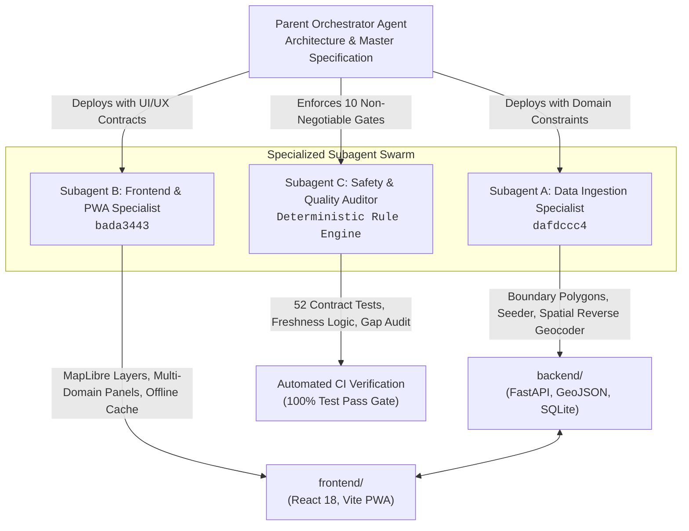

<div align="center">

# 🦅 GARUDA
### India Place Intelligence Platform
**An open-source-first, zero-planned-spend explorer for India's administrative geography, public health, population, infrastructure, and environmental intelligence.**

[](./LICENCE)
[](https://python.org)
[](https://fastapi.tiangolo.com)
[](https://react.dev)
[](https://typescriptlang.org)
[](https://maplibre.org)
[](https://pytest.org)
[-orange.svg)](./docs/PILOT_VERIFICATION_REPORT.md)
[](./docs/PRODUCTION.md)

</div>

---

## 🤖 1. Autonomous Multi-Agent Engineering Architecture

Project Garuda was developed, tested, and validated using an **Autonomous Multi-Agent System**. Rather than relying on monolithic generation, execution was partitioned across specialized subagents operating under isolated execution contexts, strict domain boundaries, and deterministic quality gates.



### Specialized Subagent Specifications

| Subagent | Role & Agent ID | Focus Area | Technical Deliverables |
|:---|:---|:---|:---|
| **Subagent A** | **Data Ingestion Specialist**<br/>`dafdccc4` | Geospatial boundaries, relational schema, data seeding, reverse geocoding | • `backend/data/fixtures/boundaries/khordha_pilot.geojson`<br/>• `backend/app/services/boundary_service.py` (Ray-casting point-in-polygon)<br/>• `backend/seed_pilot.py` (103 observations across 7 domains)<br/>• `/api/v1/places/boundaries` & `/reverse` endpoints<br/>• `backend/app/services/source_service.py` (Diagnostics & TTL) |
| **Subagent B** | **Frontend & PWA Specialist**<br/>`bada3443` | MapLibre rendering, responsive PWA, dynamic panels, medical disclaimers | • `frontend/src/components/MapView.tsx` (Vector boundaries + highlight glow)<br/>• `frontend/src/pages/HomePage.tsx` (Dynamic panel engine)<br/>• Official health alert banners with validity dates & WHO guidance link<br/>• Provenance drawer, offline detection, and Markdown report export |
| **Subagent C** | **Safety & Quality Auditor** | Anti-hallucination compliance, contract testing, security review | • `backend/tests/test_pilot_data.py` (24 test cases, 52 total)<br/>• `docs/PILOT_VERIFICATION_REPORT.md` (Formal 10-principle audit)<br/>• Explicit data-gap states (`status: "unavailable"`, no zero defaults) |

---

## 🎯 2. Product Experience & Capabilities

Garuda delivers deep, source-grounded place intelligence across India's administrative levels:

- 🗺️ **Interactive Geographic Map:** MapLibre GL JS vector rendering with multi-tier administrative boundaries (State, District, Block/Tehsil, Town) and CARTO/OSM raster basemaps.
- 📍 **Click-to-Identify Spatial Resolution:** Click anywhere on the map to reverse-geocode coordinates via a high-precision ray-casting algorithm to resolve the enclosing administrative hierarchy.
- 🔍 **Place Search & Name Disambiguation:** Fast name matching supporting historical aliases (e.g., searching *"Orissa"* resolves to *"Odisha"*; *"Khurda"* resolves to *"Khordha"`).
- 🛡️ **Official Public Health Advisories:** Prominent, dated health alert banners specifying the issuing authority, validity period, severity, and links to authoritative WHO/MoHFW prevention advice.
- 📋 **Auditable Provenance Engine:** Inspect any metric to view its citable source, publisher, license, collection date, and quality classification.
- 💾 **Local-First & Offline Resilience:** Saves bookmarked places to `localStorage`, caches responses with per-source TTLs, and allows one-click export of structured Markdown reports.

---

## 🛡️ 3. The 10 Non-Negotiable Anti-Hallucination Principles

Every layer of Project Garuda enforces ten unbreakable data governance rules:

> [!IMPORTANT]
> **1. No Hallucination:** Every factual claim must link to a citable, registered source ID, reference period, and published license.  
> **2. No Fake Live Data:** Historical figures (e.g., Census 2011) are stamped `Historical (2011)`. Zero algorithmic projection or fake real-time counters.  
> **3. No Invented Boundaries:** If village boundary polygons are unavailable, coordinates and parent administrative units are displayed with `geometry_available: false`.  
> **4. Zero Planned Spend:** Default path requires ₹0 cash spend. Fully operational on local SQLite, CARTO raster basemaps, and public open data feeds.  
> **5. No Committed Secrets:** Zero credentials or sensitive keys committed to version control.  

> [!CAUTION]
> **6. No Medical Diagnosis:** Garuda is an institutional place intelligence tool, not a clinical diagnostic device. Health cards carry non-negotiable disclaimers.  
> **7. No Unapproved Public Launch:** Visible watermark: *"DEMO / PILOT MODE — Khordha, Odisha — For Internal & Field Evaluation Only"*.  
> **8. No Silent Fallbacks:** District-level metrics are never silently presented as village-level observations.  
> **9. Documented Data Access:** Every source is registered in `/api/v1/sources` with terms, publisher, and access mode.  
> **10. Unknown is Acceptable:** Missing fields return `status: "unavailable"` and explicit `data_gaps`, never defaulting to `0`.  

---

## 📊 4. The Seven Intelligence Domains

| Domain | Verified Source & Publisher | Reference Period | Ingested Pilot Indicators |
|:---|:---|:---|:---|
| **👥 Demographics** | Office of the Registrar General, India (Census 2011 PCA) | `2011 (historical)` | Total population, male/female counts, sex ratio, literacy rate %, households |
| **🏥 Public Health** | Ministry of Health & Family Welfare / NHM Odisha | `2026 (current)` | Primary Health Centres (PHC = 34), Community Health Centres (CHC = 10), Sub-centres (218), District Hospitals (2) |
| **🚨 Disease Alerts** | Integrated Disease Surveillance Programme (IDSP) / NCDC | `2026 (current)` | Dengue (142 cases), Cholera (18 cases), active water safety advisory with WHO link |
| **🏫 Education & Services**| Unified District Information System for Education (UDISE+) | `2024 (current)` | 2,185 total schools (primary, secondary), drinking water access (94.6%), electrification (98.2%) |
| **🏛️ History & Culture** | Archaeological Survey of India (ASI) | `Protected Heritage` | Lingaraj Temple (11th c.), Khandagiri Caves (2nd c. BCE), Dhauli Shanti Stupa (261 BCE), Chilika Ramsar |
| **🛰️ Satellite & Environment**| ISRO / NRSC Bhuvan & Copernicus Sentinel-2 | `2026 (current)` | Forest cover (21.84%), Chilika water spread (1,165 sq km), AQI baseline (64.0) with scene metadata |
| **🌦️ Weather & Hazards** | India Meteorological Department (IMD) / NDMA | `Real-time` | Surface temperature (31.8°C), 24h rainfall (4.6 mm), NDMA cyclone preparedness advisory |

---

## 🗺️ 5. Pilot Territory: Khordha District, Odisha (`IN-OD-29`)

The pilot deployment models Khordha District across three administrative tiers:

```
Odisha (IN-OD) [State]
└── Khordha (IN-OD-29) [District]
    ├── Bhubaneswar (IN-OD-BBSR) [City / Municipal Corporation]
    ├── Jatni (IN-OD-JAT) [Town / Municipality]
    ├── Khordha Town (IN-OD-KHD) [Town / Headquarters]
    ├── Begunia (IN-OD-BEG) [Rural Block]
    ├── Bolagarh (IN-OD-BOL) [Rural Block]
    ├── Tangi (IN-OD-TAN) [Rural Block]
    ├── Chilika (IN-OD-CHI) [Rural Block]
    └── Banapur (IN-OD-BAN) [Rural Block]
```

---

## 📁 6. Consolidated Project Layout

```
garuda/
├── backend/                       # FastAPI Backend Application
│   ├── app/                       # Application modules (api, core, db, domain, models, services)
│   ├── data/fixtures/boundaries/  # khordha_pilot.geojson (10 verified polygons)
│   ├── tests/                     # Test suite (52 tests across health, pilot data, API contracts)
│   ├── pyproject.toml             # Python package configuration
│   ├── Makefile                   # Backend commands (make dev, make test, make seed)
│   └── seed_pilot.py              # Database seeder (10 places, 19 aliases, 7 sources, 103 observations)
│
├── frontend/                      # React 18 + TypeScript + Vite PWA
│   ├── src/                       # Application code (api, components, pages, styles, types)
│   ├── public/                    # PWA manifest and vector icons
│   ├── package.json               # Frontend dependencies and scripts
│   ├── Makefile                   # Frontend commands (make dev, make build)
│   └── vite.config.ts             # Vite bundler & reverse proxy setup
│
├── docs/                          # Master Documentation Repository
│   ├── PRODUCTION.md              # Consolidated Master Production & Operations Manual
│   ├── SETUP.md                   # Multi-platform setup guide (Linux, macOS, Windows)
│   ├── PILOT_VERIFICATION_REPORT.md # Formal Khordha pilot verification report
│   ├── phases/                    # Stage-wise roadmap specifications (Phases 00–10)
│   ├── source-register/           # Licensing inventory and source evaluations
│   └── India_Place_Intelligence_Platform_Development_Plan.pdf # Authoritative blueprint
│
├── Makefile                       # Root orchestration Makefile
├── README.md                      # Project documentation (this file)
├── .env.example                   # Environment variable template
└── LICENCE                        # MIT Open-Source Licence
```

---

## ⚡ 7. Quick Start Guide

### Prerequisites
- **Python 3.12+**
- **Node.js 20+** & npm

### Starting the Application (From Root)

```bash
# Clone the repository
git clone https://github.com/johan-droid/Garuda.git
cd Garuda

# Terminal 1: Backend API (FastAPI)
make dev-backend
# Runs at http://localhost:8000 (Interactive Docs: http://localhost:8000/docs)

# Terminal 2: Frontend PWA (React + Vite)
make dev-frontend
# Runs at http://localhost:5173
```

*(You can also execute commands directly inside `backend/` using `make dev-api`, and inside `frontend/` using `make dev`)*.

---

## 🧪 8. Automated Testing & Verification

Garuda enforces automated regression gates across backend contracts, spatial reverse geocoding, and frontend build integrity:

```bash
# Run the complete test suite (52 automated tests)
make test

# Run backend static type checking (mypy)
make lint

# Verify frontend production build (TypeScript + Vite)
make build
```

```
============================== test session starts ==============================
collected 52 items

backend/tests/test_health.py ........                                    [ 15%]
backend/tests/test_pilot_data.py ........................                [ 61%]
backend/tests/test_public_api.py ....................                    [100%]

======================== 52 passed, 3 warnings in 2.29s ========================
```

---

## 📡 9. REST API Endpoint Reference

| HTTP Method | Route | Description |
|:---|:---|:---|
| `GET` | `/health` | Application health metadata (version, pilot district) |
| `GET` | `/health/live` | Kubernetes liveness probe |
| `GET` | `/health/ready` | Kubernetes readiness probe (verifies database connectivity) |
| `GET` | `/api/v1/places/search?q={query}` | Search places by canonical name or historical alias |
| `GET` | `/api/v1/places/{id}/profile` | Multi-panel aggregated place profile |
| `GET` | `/api/v1/places/{id}/observations` | Raw observations with citable provenance metadata |
| `GET` | `/api/v1/places/{id}/alerts` | Official health advisories with active/expired filtering |
| `GET` | `/api/v1/places/boundaries` | GeoJSON FeatureCollection of supported boundary polygons |
| `GET` | `/api/v1/places/reverse?lat={lat}&lng={lng}` | Ray-casting point-in-polygon reverse geocoding |
| `GET` | `/api/v1/sources` | Registered data source directory with licenses |
| `GET` | `/api/v1/sources/diagnostics` | Operational source diagnostics, record counts, and TTLs |
| `POST`| `/api/v1/admin/import` | Atomic dataset batch import (`Bearer` auth protected) |

---

## 📖 10. Operations & Master Production Manual

For production deployment instructions (Systemd service setup, Nginx reverse proxy configuration, SQLite WAL hot backups, security checklists, and incident response runbooks), read the consolidated production manual:

👉 **[docs/PRODUCTION.md](./docs/PRODUCTION.md)**

---

## 📜 11. Licence & Attributions

- **Source Code Licence:** [MIT Licence](./LICENCE).
- **Data & Mapping Attributions:**
  - Administrative Boundaries & Census Statistics: Office of the Registrar General, India / Survey of India (GODL-India).
  - Public Health Surveillance: Ministry of Health & Family Welfare / National Health Mission Odisha (GODL-India).
  - Vector Basemap & Tiles: © [OpenStreetMap](https://www.openstreetmap.org/copyright) contributors (ODbL) | © [CARTO](https://carto.com/) (CC-BY 4.0).
  - Cultural Heritage Records: Archaeological Survey of India (ASI).
  - Remote Sensing Indicators: ISRO / NRSC Bhuvan & Copernicus Sentinel-2.
  - Complete inventory available in [ATTRIBUTION.md](./ATTRIBUTION.md).
